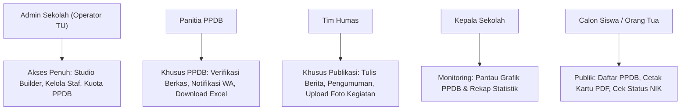

# 📘 BUKU PANDUAN PENGGUNA & PETUNJUK TEKNIS RESMI
## Sistem Informasi Profil Sekolah & Portal PPDB Online Terpadu

---

**Selamat datang di Sistem Web Profil Sekolah & PPDB Online Terpadu!**  
Dokumen ini disusun sebagai panduan operasional resmi bagi seluruh jajaran pengelola sekolah (Kepala Sekolah, Operator Tata Usaha, Panitia PPDB, dan Tim Humas) serta pedoman ringkas bagi orang tua calon siswa dalam menggunakan seluruh fitur sistem secara optimal.

---

## DAFTAR ISI

1. [Gambaran Umum Sistem & Keunggulan](#1-gambaran-umum-sistem--keunggulan)
2. [Hak Akses & Peran Pengguna (User Roles)](#2-hak-akses--peran-pengguna-user-roles)
3. [Panduan Masuk Sistem (Login)](#3-panduan-masuk-sistem-login)
4. [Petunjuk Teknis Admin Sekolah (Studio Web Builder)](#4-petunjuk-teknis-admin-sekolah-studio-web-builder)
   - [4.1 Mengubah Logo & Identitas Sekolah](#41-mengubah-logo--identitas-sekolah)
   - [4.2 Mengatur Tema Warna Sekolah](#42-mengatur-tema-warna-sekolah)
   - [4.3 Kustomisasi Menu Header (Navbar) & Footer](#43-kustomisasi-menu-header-navbar--footer)
   - [4.4 Mengedit Konten Blok Halaman](#44-mengedit-konten-blok-halaman)
   - [4.5 Menambah Blok Konten Baru (FAQ, Video, Jurusan, Testimoni)](#45-menambah-blok-konten-baru-faq-video-jurusan-testimoni)
   - [4.6 Menyusun Ulang (Reorder) & Menghapus Blok](#46-menyusun-ulang-reorder--menghapus-blok)
5. [Petunjuk Teknis Panitia PPDB (Penerimaan Siswa Baru)](#5-petunjuk-teknis-panitia-ppdb-penerimaan-siswa-baru)
   - [5.1 Membuka/Menutup Pendaftaran & Atur Kuota](#51-membukamenutup-pendaftaran--atur-kuota)
   - [5.2 Memeriksa Data & Berkas Calon Siswa](#52-memeriksa-data--berkas-calon-siswa)
   - [5.3 Mengubah Status Kelulusan](#53-mengubah-status-kelulusan)
   - [5.4 Mengirim Konfirmasi WhatsApp Otomatis ke Orang Tua](#54-mengirim-konfirmasi-whatsapp-otomatis-ke-orang-tua)
   - [5.5 Ekspor Laporan Rekap ke Format Excel (.xlsx)](#55-ekspor-laporan-rekap-ke-format-excel-xlsx)
6. [Petunjuk Teknis Tim Humas (Publikasi Berita & Agenda)](#6-petunjuk-teknis-tim-humas-publikasi-berita--agenda)
   - [6.1 Menulis Artikel & Pengumuman Baru](#61-menulis-artikel--pengumuman-baru)
   - [6.2 Mengunggah Foto Dokumentasi](#62-mengunggah-foto-dokumentasi)
   - [6.3 Menghapus atau Mengarsipkan Berita](#63-menghapus-atau-mengarsipkan-berita)
7. [Petunjuk Calon Siswa & Orang Tua Murid (PPDB Daring)](#7-petunjuk-calon-siswa--orang-tua-murid-ppdb-daring)
   - [7.1 Mengisi Formulir Pendaftaran 4 Tahap](#71-mengisi-formulir-pendaftaran-4-tahap)
   - [7.2 Mengunggah Dokumen Persyaratan](#72-mengunggah-dokumen-persyaratan)
   - [7.3 Mencetak Kartu Bukti Pendaftaran PDF](#73-mencetak-kartu-bukti-pendaftaran-pdf)
   - [7.4 Cek Status Seleksi Mandiri (via NIK)](#74-cek-status-seleksi-mandiri-via-nik)
8. [Petunjuk Manajemen Staf & Pengguna](#8-petunjuk-manajemen-staf--pengguna)
9. [Tanya Jawab Teknis & Penanganan Kendala (Troubleshooting)](#9-tanya-jawab-teknis--penanganan-kendala-troubleshooting)

---

## 1. Gambaran Umum Sistem & Keunggulan

Sistem ini adalah platform digital terintegrasi yang menggabungkan:
1. **Website Profil Sekolah Modern**: Responsif diakses dari komputer, tablet, maupun layar smartphone siswa dan orang tua.
2. **Visual Studio Builder**: Memungkinkan sekolah memperbarui foto, teks, sambutan, dan susunan seksi website secara mandiri tanpa perlu menyewa tenaga programmer.
3. **Sistem PPDB Online Terpadu**: Formulir pendaftaran digital 4 tahap dengan sistem penomoran registrasi otomatis, verifikasi berkas, dan kartu bukti pendaftaran berformat PDF.
4. **Pusat Publikasi Berita (CMS Humas)**: Media publikasi resmi prestasi, agenda sekolah, dan pengumuman kedinasan.
5. **Infrastruktur Cloud Cepat**: Menggunakan CDN global berkecepatan tinggi dengan sertifikat keamanan SSL resmi (HTTPS gembok hijau aman).

---

## 2. Hak Akses & Peran Pengguna (User Roles)

Sistem menerapkan pembagian tugas (*Role-Based Access Control*) agar data sekolah aman dan tertib:

---

## 3. Panduan Masuk Sistem (Login)

1. Buka peramban (*browser*) Google Chrome, Microsoft Edge, atau Safari.
2. Masukkan alamat URL portal login sekolah:
   👉 `https://[domain-sekolah]/login`
3. Masukkan **Email Resmi Staf** dan **Kata Sandi**.
4. Klik tombol **"Masuk ke Dashboard"**.
5. Sistem akan secara otomatis mendeteksi peran Anda dan mengarahkan ke ruang kerja yang sesuai:
   * **Operator TU / Admin** $\rightarrow$ Masuk ke Dashboard Utama / Studio Builder.
   * **Panitia PPDB** $\rightarrow$ Langsung diarahkan ke Dashboard Verifikasi PPDB.
   * **Tim Humas** $\rightarrow$ Langsung diarahkan ke Pusat Publikasi Berita.

> **Tips Keamanan:** Jangan pernah membagikan kata sandi akun Anda kepada siapapun. Selalu klik tombol *Keluar (Logout)* jika selesai menggunakan komputer bersama di ruang guru/tata usaha.

---

## 4. Petunjuk Teknis Admin Sekolah (Studio Web Builder)

Studio Web Builder dapat diakses melalui menu **Studio Builder** atau tautan:
👉 `https://[domain-sekolah]/builder`

Di layar sebelah kiri terdapat 4 Tab Utama:
* **Tata Letak**: Mengedit isi teks, foto, menambah, menghapus, atau menggeser susunan seksi.
* **Nav & Footer**: Mengatur logo header, tombol PPDB, dan tautan media sosial di footer.
* **Warna**: Mengubah palet warna identitas sekolah.
* **Profil**: Mengatur identitas resmi sekolah dan mengunggah logo.

### 4.1 Mengubah Logo & Identitas Sekolah
1. Buka Tab **Profil** di panel kiri.
2. Pada bagian **Identitas & Logo Resmi**, klik tombol **"Pilih Foto dari Perangkat"**.
3. Pilih file logo resmi sekolah (format PNG transparan sangat disarankan). Foto otomatis tersimpan dan langsung tampil di Navbar dan Footer sekolah.
4. Lengkapi kolom **Nama Resmi Sekolah**, **Jenjang** (SD/SMP/SMA/SMK/Madrasah), **NPSN** (8 digit), dan **Slogan Sekolah**.

### 4.2 Mengatur Tema Warna Sekolah
1. Buka Tab **Warna**.
2. Anda dapat memilih salah satu palet warna cepat siap pakai:
   * *Biru Resmi* (Cocok untuk SMP / SMA Negeri)
   * *Hijau Islami* (Cocok untuk Madrasah / Pesantren / Yayasan Islam)
   * *Merah Edukasi* (Cocok untuk Sekolah Dasar / Pembinaan)
   * *Navy Modern* (Cocok untuk SMK / Kejuruan Teknik)
   * *Teal Alam* (Cocok untuk Sekolah Alam / Adiwiyata)
3. Atau tentukan sendiri kode warna sekolah pada kolom **Warna Utama** dan **Warna Aksen**.

### 4.3 Kustomisasi Menu Header (Navbar) & Footer
1. Buka Tab **Nav & Footer**.
2. **Pengaturan Header**:
   * Centang opsi *Tampilkan Logo Sekolah*.
   * Centang *Tampilkan Badge NPSN & Akreditasi*.
   * Centang *Header Melayang (Sticky)* agar menu tetap terlihat saat pengunjung menggulir ke bawah.
   * Centang *Tampilkan Tombol PPDB* dan sesuaikan teksnya (contoh: `Daftar PPDB 2026/2027`).
3. **Pengaturan Footer & Media Sosial**:
   * Masukkan ringkasan profil sekolah dan teks hak cipta (*copyright*).
   * Masukkan akun Instagram, YouTube, Facebook, dan nomor WhatsApp resmi sekolah. Ikon media sosial akan otomatis muncul di bagian bawah website.
   * Masukkan alamat lengkap, nomor telepon, email, dan jam buka kantor tata usaha.

### 4.4 Mengedit Konten Blok Halaman
1. Buka Tab **Tata Letak**.
2. Klik ikon **Pensil (Edit)** pada blok yang ingin diperbarui:
   * **Hero Banner**: Ubah judul utama (headline), sub-headline, dan foto banner gedung utama.
   * **Sambutan Kepala Sekolah**: Masukkan nama Kepala Sekolah, gelar, visi sekolah, serta foto resmi kepala sekolah.
   * **Fasilitas**: Tambah sarana belajar (Lab Komputer, Lapangan, Perpustakaan), tuliskan deskripsi singkat, dan pasang foto fasilitas.
   * **Prestasi Siswa**: Catat nama kejuaraan, nama siswa/tim peraih, tingkat perlombaan (Kota/Provinsi/Nasional), tahun, dan foto medali/piagam.
   * **Guru & Tenaga Kependidikan**: Masukkan nama lengkap guru, bidang studi yang diampu, dan pasfoto guru.
   * **Galeri Foto**: Tambahkan foto dokumentasi kegiatan upacara, ekstrakurikuler, dan kegiatan siswa.
3. Setelah selesai mengisi formulir, klik tombol **"Selesai Edit Konten"**.

### 4.5 Menambah Blok Konten Baru (FAQ, Video, Jurusan, Testimoni)
1. Di Tab **Tata Letak**, klik tombol berwarna biru: **`+ Tambah Section`**.
2. Pilih salah satu template blok yang Anda butuhkan:
   * **Pertanyaan Umum (FAQ)**: Membuat daftar akordeon tanya-jawab seputar PPDB, SPP gratis, seragam, dan aturan sekolah.
   * **Video Profil Sekolah**: Memasang video profil atau dokumenter yang sudah diunggah di YouTube (cukup tempel link video YouTube-nya).
   * **Program & Jurusan**: Menampilkan kartu konsentrasi keahlian (sangat cocok untuk SMK, peminatan IPA/IPS di SMA, atau kelas tahfidz).
   * **Testimoni Alumni & Ortu**: Menampilkan kutipan pengalaman alumni sukses atau wali murid.
   * **Banner Ajakan PPDB (CTA)**: Spanduk ajakan pendaftaran di bagian bawah halaman.
3. Blok baru akan langsung muncul di halaman dan siap diisi datanya.

### 4.6 Menyusun Ulang (Reorder) & Menghapus Blok
* **Menggeser Urutan**: Pada Tab *Tata Letak*, tahan dan seret (*drag-and-drop*) ikon titik enam di sebelah kiri nama blok ke atas atau ke bawah.
* **Menyembunyikan Blok**: Klik ikon **Mata** jika ada blok yang ingin disembunyikan sementara tanpa menghapusnya.
* **Menghapus Blok**: Klik ikon **Tempat Sampah** untuk menghapus blok permanen.
* **Menyimpan Perubahan**: Jangan lupa klik tombol biru **"Simpan"** di pojok kanan atas layar!

---

## 5. Petunjuk Teknis Panitia PPDB (Penerimaan Siswa Baru)

Pusat kerja panitia PPDB berada di:
👉 `https://[domain-sekolah]/dashboard/ppdb`

### 5.1 Membuka/Menutup Pendaftaran & Atur Kuota
1. Buka `/builder` $\rightarrow$ Tab **Profil**.
2. Pada bagian **Status Penerimaan Siswa Baru (PPDB)**:
   * Centang kotak *Buka Pendaftaran PPDB Online* saat periode pendaftaran dimulai.
   * Hapus centang jika kuota sudah terpenuhi atau gelombang pendaftaran telah berakhir.
   * Masukkan tahun ajaran aktif (contoh: `2026/2027`) dan nomor WhatsApp panitia untuk konsultasi.

### 5.2 Memeriksa Data & Berkas Calon Siswa
1. Masuk ke [`/dashboard/ppdb`](file:///c:/Users/User/Documents/Web%20Project/Antigravity-AI/webAppBuilder/src/app/dashboard/ppdb/page.tsx).
2. Di tabel pendaftar, klik tombol **Periksa Berkas (Ikon Mata)** pada baris siswa yang bersangkutan.
3. Jendela detail akan terbuka menampilkan:
   * Biodata siswa (NISN, NIK, tanggal lahir, sekolah asal, alamat).
   * Kontak orang tua (Nama ayah/ibu, pekerjaan, nomor WhatsApp).
   * Foto pasfoto siswa, Kartu Keluarga, Akta Kelahiran, dan Surat Keterangan Lulus/Piagam.

### 5.3 Mengubah Status Kelulusan
Pada kolom status siswa, pilih salah satu status seleksi:
* 🟡 **Menunggu Verifikasi (Pending)**: Siswa baru saja mendaftar dan berkas belum diperiksa.
* 🔵 **Berkas Terverifikasi (Verified)**: Seluruh dokumen persyaratan sah dan lengkap.
* 🟢 **Diterima / Lulus (Accepted)**: Siswa dinyatakan lolos seleksi penerimaan.
* 🟠 **Perlu Revisi (Need Revision)**: Ada berkas yang buram, salah upload, atau belum lengkap.
* 🔴 **Tidak Lolos (Rejected)**: Tidak memenuhi syarat jalur yang dipilih.
* ⚪ **Cadangan (Reserved)**: Masuk daftar antrean kuota tambahan.

### 5.4 Mengirim Konfirmasi WhatsApp Otomatis ke Orang Tua
1. Pada tabel siswa, klik tombol berikon **WhatsApp** berwarna hijau.
2. Aplikasi otomatis membuka chat WhatsApp resmi ke nomor orang tua siswa.
3. Pesan konfirmasi kelulusan, nomor registrasi, dan instruksi daftar ulang **sudah otomatis terketik rapi**, panitia cukup menekan tombol **Kirim (Send)**!

### 5.5 Ekspor Laporan Rekap ke Format Excel (.xlsx)
1. Di pojok kanan atas halaman PPDB, klik tombol **"Ekspor Excel (.xlsx)"**.
2. File spreadsheet Excel langsung terunduh secara otomatis berisi seluruh data siswa lengkap (Nomor Registrasi, Nama, Jalur, NISN, NIK, Nilai, Status, No HP Ortu).
3. File ini siap dicetak atau diserahkan sebagai laporan resmi ke Dinas Pendidikan / Kemenag.

---

## 6. Petunjuk Teknis Tim Humas (Publikasi Berita & Agenda)

Pusat publikasi berita berada di:
👉 `https://[domain-sekolah]/dashboard/posts`

### 6.1 Menulis Artikel & Pengumuman Baru
1. Masuk ke `/dashboard/posts`, lalu klik tombol **"Tulis Artikel Baru"**.
2. Masukkan **Judul Artikel** (contoh: *"SMP Negeri 1 Raih Juara Umum Lomba Robotik Tingkat Provinsi"*).
3. Pilih **Kategori**:
   * *Berita Sekolah*
   * *Pengumuman Resmi*
   * *Prestasi Juara*
   * *Agenda Kegiatan*
4. Tuliskan **Ringkasan Singkat (Summary)** sebanyak 1-2 kalimat untuk kartu depan berita.
5. Tuliskan **Isi Konten Lengkap** berita atau instruksi pengumuman.

### 6.2 Mengunggah Foto Dokumentasi
1. Pada bagian **Foto Sampul Artikel**, klik tombol **"Pilih Foto dari Perangkat"**.
2. Pilih foto kegiatan dari galeri laptop atau HP Anda.
3. Foto otomatis diunggah ke server cloud dan pratinjau thumbnail langsung muncul.
4. Klik tombol **"Publikasikan Sekarang"**. Artikel akan langsung tayang di portal publik sekolah `/s/[slug]/berita`.

### 6.3 Menghapus atau Mengarsipkan Berita
* Pada daftar artikel di dashboard, klik ikon **Tempat Sampah** untuk menghapus berita yang sudah tidak berlaku lagi.

---

## 7. Petunjuk Calon Siswa & Orang Tua Murid (PPDB Daring)

*(Bagian ini dapat disalin untuk dicetak pada brosur pendaftaran atau dibagikan melalui grup WhatsApp wali murid)*.

### 7.1 Mengisi Formulir Pendaftaran 4 Tahap
1. Buka website resmi sekolah melalui HP atau komputer: `https://[domain-sekolah]/ppdb`.
2. **Tahap 1**: Pilih **Jalur Pendaftaran** yang sesuai (Zonasi, Prestasi, Afirmasi, atau Perpindahan Tugas Orang Tua).
3. **Tahap 2**: Lengkapi **Biodata Siswa** (Nama Lengkap, NIK, NISN, Jenis Kelamin, Tempat/Tanggal Lahir, Asal Sekolah, dan Alamat Domisili).
4. **Tahap 3**: Lengkapi **Data Orang Tua / Wali** serta masukkan **Nomor WhatsApp aktif** untuk menerima pengumuman.
5. **Tahap 4**: Unggah foto dokumen yang diminta:
   * Pasfoto terbaru siswa.
   * Foto Kartu Keluarga (KK).
   * Foto Akta Kelahiran.
   * Foto Surat Keterangan Rapor / Sertifikat Piagam Prestasi (jika ada).
6. Centang pernyataan kebenaran data, lalu klik **"Kirim Pendaftaran Sekarang"**.

### 7.2 Mencetak Kartu Bukti Pendaftaran PDF
* Setelah tombol kirim ditekan, layar akan menampilkan konfirmasi sukses beserta **Nomor Registrasi Resmi** (contoh: `REG-2026-SMP1-0042`).
* Klik tombol **"Unduh / Cetak Bukti Pendaftaran (PDF)"**.
* Simpan file PDF ini di HP atau cetak sebagai bukti sah saat daftar ulang fisik di sekolah.

### 7.3 Cek Status Seleksi Mandiri (via NIK)
* Wali murid tidak perlu bolak-balik datang ke sekolah untuk menanyakan hasil seleksi.
* Buka menu **PPDB $\rightarrow$ Cek Status Pendaftaran**.
* Masukkan **16 Digit NIK Siswa** atau **Nomor Registrasi**, lalu klik Cari.
* Sistem akan menampilkan status terkini berkas putra-putri Anda secara transparan.

---

## 8. Petunjuk Manajemen Staf & Pengguna

Hanya dapat diakses oleh **Kepala Sekolah** dan **Admin Utama (Operator TU)** di:
👉 `https://[domain-sekolah]/dashboard/staf`

### Cara Menambah Panitia / Guru Baru:
1. Klik tombol **"+ Tambah Staf Baru"**.
2. Masukkan **Nama Lengkap & Gelar** (contoh: *Budi Santoso, S.Pd.*).
3. Masukkan **Email Aktif** dan **Nomor WhatsApp**.
4. Pilih **Tugas / Peran**:
   * *Admin Sekolah (TU)*: Untuk operator komputer utama.
   * *Panitia PPDB*: Untuk guru yang bertugas memeriksa berkas pendaftaran siswa.
   * *Editor Humas*: Untuk guru/staf yang bertugas mengunggah berita kegiatan.
   * *Kepala Sekolah*: Untuk pimpinan yang memantau rekap data.
5. Klik **Simpan Anggota Staf**.

### Menonaktifkan Staf:
* Jika periode PPDB telah selesai, admin cukup mengklik status staf menjadi **Non-Aktif** agar hak akses panitia tertutup kembali demi menjaga keamanan data siswa.

---

## 9. Tanya Jawab Teknis & Penanganan Kendala (Troubleshooting)

#### Q1: Foto fasilitas / guru gagal diunggah?
* **Penyebab**: Ukuran file terlalu besar atau format file tidak sesuai.
* **Solusi**: Gunakan file berformat JPG, PNG, atau WEBP dengan ukuran di bawah 5 MB. Jika mengambil foto dari kamera HP beresolusi sangat tinggi (di atas 10 MB), kirimkan terlebih dahulu foto tersebut via WhatsApp agar terkompresi otomatis sebelum diunggah.

#### Q2: Perubahan teks di Studio Builder belum muncul di website publik?
* **Penyebab**: Peramban Anda menyimpan memori cache lama, atau tombol "Simpan" belum ditekan.
* **Solusi**: Pastikan tombol biru **"Simpan"** di pojok kanan atas builder sudah berubah menjadi tanda centang hijau *"Tersimpan!"*. Kemudian buka website publik dan lakukan *Hard Refresh* dengan menekan tombol **Ctrl + F5** (di Windows) atau bersihkan cache browser.

#### Q3: File Excel PPDB tidak bisa dibuka atau format berantakan?
* **Penyebab**: Versi Microsoft Excel versi lawas.
* **Solusi**: File ekspor berformat `.xlsx` standar internasional. Dapat dibuka dengan lancar di Microsoft Excel 2016, 2019, 2021, Office 365, WPS Office, maupun Google Sheets.

#### Q4: Bagaimana jika ada orang tua salah memasukkan data saat mendaftar PPDB?
* **Solusi**: Panitia PPDB dapat mengubah status siswa tersebut menjadi **Perlu Perbaikan (Need Revision)** dan menghubungi nomor WhatsApp orang tua untuk meminta perbaikan dokumen yang benar.

---

**Pusat Bantuan & Layanan Pemeliharaan Sistem:**  
Jika sekolah Anda membutuhkan bantuan konfigurasi teknis lanjutan, perpanjangan domain, atau penambahan fitur khusus, silakan hubungi tim pengembang melalui nomor kontak administrator yang tertera pada perjanjian kerja sama pengadaan sistem.
